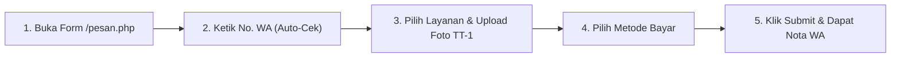

# PANDUAN STANDAR OPERASIONAL PROSEDUR (SOP)
## SISTEM MANAJEMEN FOOTSTEPSZS SHOE CARE & ONLINE SELF-ORDER

> **Versi:** 1.0 (Bahasa Ringkas & Praktis)  
> **Target Pengguna:** Pemilik Toko, Kasir / Staf Operasional, & Pelanggan  
> **Basis Sistem:** Web POS, Self-Order Publik, WhatsApp Notifikasi, & DMS

---

## DAFTAR ISI CEPAT

1. [Mengenal Sistem & Peran Pengguna](#1-mengenal-sistem--peran-pengguna)
2. [Cara Membuka & Menjalankan Sistem](#2-cara-membuka--menjalankan-sistem)
3. [SOP 1: Pemesanan Mandiri oleh Pelanggan (Online Order)](#3-sop-1-pemesanan-mandiri-oleh-pelanggan-online-order)
4. [SOP 2: Kasir Menerima & Memproses Order (Dari Cuci sampai Siap)](#4-sop-2-kasir-menerima--memproses-order-dari-cuci-sampai-siap)
5. [SOP 3: Input Pesanan Langsung di Toko (Walk-in / Offline)](#5-sop-3-input-pesanan-langsung-di-toko-walk-in--offline)
6. [SOP 4: Kontrol Mutu Foto (TT-1 & TT-2) dan Nota Digital](#6-sop-4-kontrol-mutu-foto-tt-1--tt-2-dan-nota-digital)
7. [SOP 5: Pengelolaan Paket Membership & Kuota Cuci](#7-sop-5-pengelolaan-paket-membership--kuota-cuci)
8. [SOP 6: Pencatatan Uang Kas & Pengeluaran Toko (Cashflow)](#8-sop-6-pencatatan-uang-kas--pengeluaran-toko-cashflow)
9. [SOP 7: Otomasi Sistem & Pembatalan Otomatis (Cron Job)](#9-sop-7-otomasi-sistem--pembatalan-otomatis-cron-job)
10. [Tanya Jawab Singkat (FAQ) & Masalah yang Sering Terjadi](#10-tanya-jawab-singkat-faq--masalah-yang-sering-terjadi)

---

## 1. MENGENAL SISTEM & PERAN PENGGUNA

Sistem ini dibuat untuk memudahkan operasional laundry sepatu, tas, dan topi, agar pencatatan tidak tercecer di chat WhatsApp dan kondisi fisik sepatu tercatat rapi sejak datang sampai selesai.

### Siapa Saja Penggunanya?
1. **Pelanggan (Customer):**
   * Bisa pesan langsung lewat web tanpa wajib bikin akun (Guest Checkout).
   * Cukup ketik nomor WhatsApp, sistem langsung mengenali jika pelanggan adalah member lama.
   * Mendapat nota otomatis dan kabar pengerjaan langsung ke WhatsApp.
2. **Kasir / Staf Operasional (Admin):**
   * Memantau antrean pesanan via Papan Kanban (Cuci, Kering, Siap Kirim, Selesai).
   * Memvalidasi pembayaran (Transfer/QRIS/COD).
   * Mengunggah foto hasil cuci sebelum barang diserahkan ke pelanggan.
   * Mencatat pengeluaran harian toko (beli sabun, kurir, dll).
3. **Sistem Otomatis (Background):**
   * Menghitung kuota member secara otomatis (Rp 0 / lunas kuota).
   * Mengirim notifikasi WhatsApp via Fonnte API.
   * Membatalkan pesanan otomatis jika belum bayar dalam waktu 24 jam.

---

## 2. CARA MEMBUKA & MENJALANKAN SISTEM

### A. Jika Menggunakan Komputer Toko (Docker / Localhost)
1. Pastikan aplikasi Docker Desktop atau XAMPP sudah aktif.
2. Buka aplikasi peramban (Google Chrome, Edge, dsb).
3. Ketik alamat:
   * **Halaman Depan Pelanggan:** `http://localhost:8080/` atau `http://localhost:8080/pesan.php`
   * **Halaman Masuk Kasir / Admin:** `http://localhost:8080/login.php`

### B. Akun Masuk (Login) Default
| Peran | Username / No. HP | Password |
|---|---|---|
| **Admin / Kasir** | `admin` | `password` (atau `admin123`) |
| **Pelanggan Member** | Nomor WhatsApp terdaftar | Sesuai saat registrasi |

---

## 3. SOP 1: PEMESANAN MANDIRI OLEH PELANGGAN (ONLINE ORDER)

Alur ini dilakukan pelanggan saat membuka link pemesanan dari bio Instagram atau link chat.

### Langkah-langkah:
1. **Buka Halaman Pemesanan:** Buka menu **Pesan Sekarang** (`pesan.php`). Tidak perlu mendaftar akun terlebih dahulu.
2. **Ketik Nomor WhatsApp:**
   * Masukkan nomor WhatsApp aktif (contoh: `081234567890`).
   * *Otomatis:* Jika nomor sudah pernah pesan sebelumnya, nama dan alamat otomatis terisi.
   * *Otomatis:* Jika nomor terdaftar sebagai **Member Aktif**, akan muncul kotak hijau info kuota dan diskon member.
3. **Pilih Layanan & Perawatan:**
   * Tentukan jenis barang: Sepatu, Tas, atau Topi.
   * Tentukan jenis perawatan (misal: *Deep Cleaning*, *Fast Clean*, *Whitening/Unyellowing*, *Repaint*).
   * Tentukan jumlah (pasang/buah).
4. **Wajib Unggah Foto Awal (Tanda Terima 1 / TT-1):**
   * Pelanggan wajib memotret atau memilih foto kondisi sepatu saat ini dari galeri HP.
   * *Penting:* Foto ini adalah bukti sah kondisi awal barang agar tidak terjadi salah paham jika ada noda membandel atau bagian yang memang sudah rusak sebelumnya.
5. **Pilih Metode Pembayaran:**
   * **COD (Bayar di Tempat):** Bayar tunai saat sepatu diambil atau saat diantar kurir.
   * **Transfer Bank / QRIS:** Muncul nomor rekening atau barcode QRIS toko.
6. **Kirim Pesanan (Submit):**
   * Tekan tombol **"Konfirmasi Pemesanan"**.
   * Layar menampilkan **Nomor Order Unik** (misal: `ORD-202611-0012`) dan tombol unduh Nota Masuk (Nota IN).
   * Nomor WhatsApp pelanggan otomatis menerima pesan konfirmasi pemesanan dan tautan nota digital.

---

## 4. SOP 2: KASIR MENERIMA & MEMPROSES ORDER

Alur harian staf toko untuk memproses sepatu dari kotor sampai bersih dan siap diambil.

### Langkah-langkah:

#### Tahap 1: Cek Pesanan Masuk
1. Kasir login ke `login.php` menggunakan akun admin.
2. Masuk ke menu **Daftar Pesanan (Kanban)** di `/admin/orders.php`.
3. Pesanan baru akan berada di kolom:
   * **Pending Payment:** Khusus pesanan Transfer/QRIS yang belum diverifikasi pembayarannya.
   * **Cuci:** Pesanan COD atau Member yang siap langsung dicuci.

#### Tahap 2: Validasi Pembayaran (Set Lunas)
1. Jika pesanan memakai Transfer/QRIS, periksa mutasi rekening bank atau bukti bayar pelanggan.
2. Jika uang sudah masuk, klik tombol hijau **"Set Lunas"**.
3. Status pembayaran berubah menjadi **Lunas**, status pengerjaan otomatis maju ke tahap **Cuci**, dan uang otomatis tercatat ke pembukuan kas masuk.

#### Tahap 3: Update Status Pengerjaan Sepatu
Klik kartu pesanan atau buka menu **Detail Order** (`order_detail.php`), lalu ubah status bertahap sesuai kondisi nyata:
1. **Status "Cuci":** Sepatu sedang direndam, disikat, atau masuk tahap pembersihan mendalam.
2. **Status "Kering":** Sepatu sudah selesai disikat dan sedang berada di ruang pengering (*dryer cabinet* atau diangin-anginkan).
3. **Status "Siap Kirim":** Sepatu sudah kering sempurna, wangi, dipasangi *tag*, dan dimasukkan ke dalam plastik kemasan khusus (*ziplock/dustbag*).

> **PENTING UNTUK KASIR:**  
> Saat status dipindahkan ke **Siap Kirim**, sistem akan **membuka kunci Form Upload Foto Akhir (TT-2)**.

---

## 5. SOP 3: INPUT PESANAN LANGSUNG DI TOKO (WALK-IN / OFFLINE)

Jika ada pelanggan yang datang langsung mengantarkan sepatu ke counter/toko:

1. Buka menu **Buat Order Baru** di admin (`/admin/order_create.php`).
2. Masukkan nomor WhatsApp pelanggan:
   * Jika pelanggan lama, data nama langsung muncul otomatis.
   * Jika pelanggan baru, isikan nama lengkapnya.
3. Pilih jenis treatment dan jumlah sepatu.
4. Ambil foto fisik sepatu pelanggan saat itu juga menggunakan kamera HP/tablet kasir (TT-1).
5. Pilih pembayaran: Bayar Langsung (Lunas) atau Bayar Nanti Saat Ambil (COD).
6. Klik **Simpan Pesanan**.
7. Cetak **Nota IN** atau kirimkan link nota digital langsung ke WhatsApp pelanggan.

---

## 6. SOP 4: KONTROL MUTU FOTO (TT-1 & TT-2) DAN NOTA DIGITAL

Sistem ini menerapkan standar kendali mutu tanpa kompromi melalui dokumen foto:

| Dokumen | Kapan Diunggah? | Oleh Siapa? | Fungsi Utama |
|---|---|---|---|
| **TT-1 (Tanda Terima 1)** | Awal saat pemesanan | Pelanggan / Kasir | Bukti kondisi kotor/cacat awal sebelum dikerjakan |
| **TT-2 (Tanda Terima 2)** | Saat status **Siap Kirim** | Kasir / Tim QC | Bukti hasil pengerjaan bersih & rapi sebelum diserahkan |
| **Nota IN** | Otomatis dibuat saat order tersimpan | Sistem | Kuitansi tanda terima barang masuk |
| **Nota OUT** | Dibuat setelah TT-2 diupload | Kasir / Sistem | Bukti serah terima barang keluar & garansi cuci |

### Prosedur Upload TT-2 (Foto Hasil Bersih):
1. Buka detail order di `/admin/order_detail.php`.
2. Pastikan status order sudah berada di **Siap Kirim**.
3. Gulir ke bagian **"Upload Foto Akhir Pengerjaan (TT-2)"**.
4. Foto setiap pasang sepatu yang telah selesai (tampilan bersih, rapi, dan siap diserahkan).
5. Klik **"Simpan Foto Hasil & Terbitkan Nota OUT"**.
6. Klik tombol **"Kirim Notifikasi WA Siap Ambil"** agar pelanggan menerima kabar bahwa sepatunya sudah wangi dan siap dijemput/diantar.

---

## 7. SOP 5: PENGELOLAAN PAKET MEMBERSHIP & KUOTA CUCI

Program member ditujukan untuk pelanggan setia dengan sistem paket bulanan (masa aktif 30 hari).

### Paket Membership yang Berlaku:
* **Bronze (Rp 160.000 / bln):** Kuota **4 pasang** cuci gratis + Diskon ekstra treatment 5%.
* **Silver (Rp 300.000 / bln):** Kuota **8 pasang** cuci gratis + Diskon ekstra treatment 10%.
* **Gold (Rp 590.000 / bln):** Kuota **16 pasang** cuci gratis + Diskon ekstra treatment 15% + Prioritas express.

### Cara Kerja Kuota di Kasir:
1. Saat pelanggan member memesan (online maupun offline), kuota cucinya otomatis berkurang sesuai jumlah sepatu yang dicuci.
2. Jika kuota masih ada, biaya cuci otomatis dihitung **Rp 0 (Dicover Kuota Member)**.
3. Kasir dapat memantau sisa kuota dan tanggal kadaluarsa member melalui menu **Manajemen Member** (`/admin/members.php`).
4. Jika masa aktif member tinggal 3 hari (H-3), sistem otomatis memberi penanda kuning untuk mengingatkan pelanggan memperpanjang masa aktif.
5. Kasir dapat mencetak **Kartu Member Digital** dan riwayat transaksi member dari menu tersebut.

---

## 8. SOP 6: PENCATATAN UANG KAS & PENGELUARAN TOKO (CASHFLOW)

Agar keuangan toko rapi dan pemilik bisa memantau laba harian tanpa salah hitung:

### A. Uang Masuk (Pemasukan / Cash-In)
* **Otomatis:** Setiap kali kasir menekan tombol "Set Lunas" pada pesanan laundry atau pendaftaran member baru, uang tersebut otomatis masuk ke tabel kasir sebagai **Pemasukan**. Kasir tidak perlu mencatat ulang secara manual.

### B. Uang Keluar (Pengeluaran / Cash-Out)
Setiap ada pengeluaran operasional toko sekecil apa pun, kasir wajib mencatatnya:
1. Buka menu **Buku Keuangan** (`/admin/keuangan.php`).
2. Klik tombol **"Catat Pengeluaran"**.
3. Isi data:
   * **Kategori:** Pilih yang sesuai (misal: *Bahan Kimia/Sabun*, *Plastik Packaging*, *Bensin Kurir*, *Konsumsi/Listrik*, *Lain-lain*).
   * **Jumlah (Rp):** Nominal pengeluaran nyata (misal: Rp 35.000).
   * **Keterangan:** Tuliskan keperluan secara jelas (contoh: *Beli cleaner sabun sepatu 1 liter*).
   * **Tanggal:** Tanggal terjadinya pengeluaran.
4. Klik **Simpan Transaksi**.

### C. Melihat Rekap & Laporan Untung Rugi
1. Buka menu **Laporan** (`/admin/reports.php`).
2. Kasir atau pemilik dapat memilih filter periode (Harian, Mingguan, atau Bulanan).
3. Halaman menampilkan:
   * **Total Omset (Pemasukan)**
   * **Total Biaya Operasional (Pengeluaran)**
   * **Arus Kas Bersih (Net Profit)**
4. Klik tombol **"Cetak Laporan / Export"** untuk arsip fisik atau laporan ke pemilik toko.

---

## 9. SOP 7: OTOMASI SISTEM & PEMBATALAN OTOMATIS (CRON JOB)

Sistem memiliki "asisten otomatis" yang bekerja di latar belakang tanpa perlu disentuh terus-menerus:

1. **Auto-Cancel Order 24 Jam (`cron/auto_cancel.php`):**
   * Jika pelanggan memesan via online dengan metode Transfer Bank / QRIS tetapi tidak membayar dalam waktu **24 jam**, sistem akan otomatis mengubah status menjadi **Dibatalkan (Canceled)**.
   * Kuota antrean tidak akan tersumbat oleh pesanan palsu (*fake order*).
2. **Auto-Sync Masa Aktif Member (`cron/member_tracker.php`):**
   * Setiap hari sistem memeriksa tanggal berakhir paket member.
   * Jika sudah lewat 30 hari, status member otomatis berubah dari *Aktif* menjadi *Nonaktif*.
3. **Notifikasi WhatsApp Real-time:**
   * Notifikasi otomatis terkirim pada saat:
     - Pesanan baru berhasil dibuat (berisi rincian nota & instruksi transfer).
     - Pembayaran telah dikonfirmasi kasir (status berubah jadi Cuci).
     - Sepatu selesai dikerjakan & siap diambil (status Siap Kirim + link foto TT-2).
     - Pesanan dibatalkan jika kadaluarsa 24 jam.

---

## 10. TANYA JAWAB SINGKAT (FAQ) & MASALAH YANG SERING TERJADI

### Q1: Pelanggan salah pilih treatment saat pesan online, bagaimana cara kasir memperbaikinya?
**Jawaban:** Buka menu **Daftar Pesanan**, klik tombol **Edit** pada pesanan terkait. Kasir dapat menyesuaikan jenis treatment, harga, atau menambah catatan khusus dari pelanggan.

### Q2: Pelanggan tidak punya bukti transfer tapi mengaku sudah bayar, apa yang harus dilakukan?
**Jawaban:** Kasir **DILARANG KERAS** menekan tombol "Set Lunas" sebelum mengecek mutasi rekening bank atau aplikasi QRIS toko. Status harus tetap berada di *Pending Payment* sampai uang benar-benar masuk.

### Q3: Kenapa form upload foto TT-2 tidak bisa diklik / berwarna abu-abu?
**Jawaban:** Ini adalah fitur pengaman kualitas. Form TT-2 hanya akan terbuka jika status pengerjaan sudah dinaikkan ke **"Siap Kirim"**. Pastikan kasir memperbarui status pengerjaan terlebih dahulu.

### Q4: Apakah pelanggan harus install aplikasi?
**Jawaban:** Tidak perlu. Sistem berbasis web responsif, bisa dibuka dari peramban HP apa saja (Chrome, Safari, WhatsApp in-app browser).

### Q5: Bagaimana jika pesan WhatsApp konfirmasi tidak terkirim ke HP pelanggan?
**Jawaban:**
1. Pastikan nomor yang diinput berawalan `08...` atau `628...` (sistem sudah otomatis menormalkan format nomor).
2. Pastikan paket langganan dan Token Fonnte API di toko masih aktif di file konfigurasi (`includes/koneksi.php`).
3. Pelanggan tetap bisa melihat nota kapan saja lewat halaman konfirmasi atau portal member.

---

*Dokumen SOP ini disusun sebagai acuan operasional harian Footstepszs Shoe Care.*  
*Pastikan setiap staf baru membaca dan mempraktikkan alur ini demi menjaga kepuasan pelanggan dan kerapian administrasi toko.*
