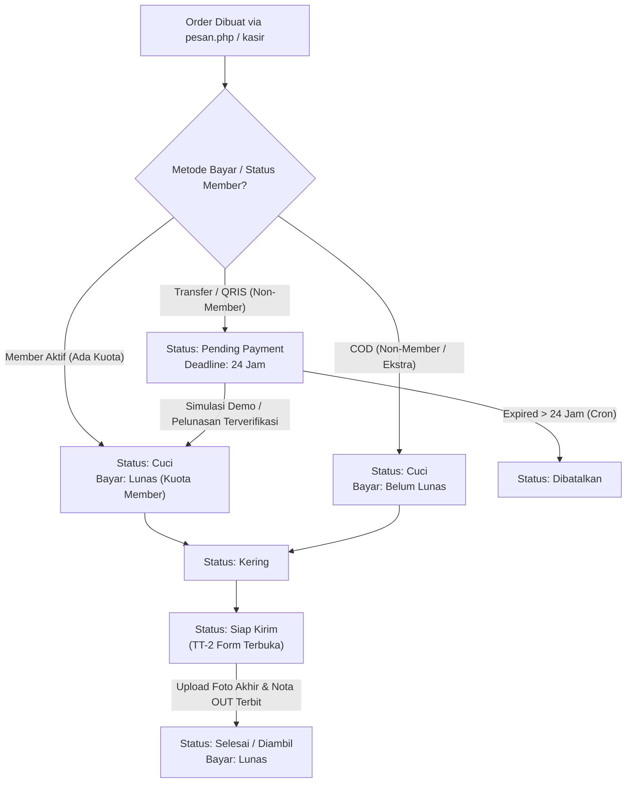

# HANDOFF DOCUMENTATION — FOOTSTEPSZS PREMIUM CARE SYSTEM
**Dokumen Serah Terima Teknis & Operasional Sistem Informasi Manajemen Laundry Sepatu**  
*Versi:* 2.0.0 (Production-Ready)  
*Terakhir Diperbarui:* 1 November 2026  
*Status:* Verified, Audited, Containerized  

---

## 1. Ringkasan Eksekutif & Tujuan Proyek

**Footstepszs Premium Care** adalah platform manajemen operasional dan layanan pemesanan digital untuk bisnis laundry dan artisan treatment sepatu, tas, dan topi berbasis di Malang Raya. Sistem ini menghubungkan:
1. **Front-facing Customer Order System:** Pemesanan mandiri oleh pelanggan, integrasi membership otomatis, verifikasi nomor WhatsApp otomatis, upload foto awal kondisi fisik (Tanda Terima 1 / TT-1), serta pilihan pembayaran tunai (COD), Transfer Bank, dan QRIS Statis.
2. **Customer Portal:** Dashboard riwayat pengerjaan, kuota bulanan aktif, serta akses nota digital (Nota IN & Nota OUT).
3. **Administrator & Cashier Workspace:** Manajemen antrean berbasis status pengerjaan, penguncian foto akhir (TT-2) hingga status siap kirim, validasi penerimaan pembayaran, manajemen kas kecil/cashflow harian, DMS (Document Management System), dan pelaporan keuangan.

---

## 2. Arsitektur Teknologi & Lingkungan Eksekusi

### 2.1 Tech Stack
* **Bahasa & Backend:** PHP 8.2 (Modular Procedural dengan OOP helpers).
* **Database:** MariaDB 10.6 (InnoDB, UTF-8 Multilingual).
* **Frontend:** Vanilla HTML5, CSS kustom responsif (anti-slop, clean minimal typography, tanpa emoji informal), interaktivitas Vanilla JavaScript modern.
* **Integrasi WhatsApp:** Fonnte API Gateway (Notifikasi instan konfirmasi order, invoice link, dan update status pengerjaan).
* **Containerization:** Docker & Docker Compose (Multi-container: Web Apache + PHP 8.2 & MariaDB).

### 2.2 Akses & Kredensial Default

| Komponen | Host / Port | Username | Password / Keterangan |
| :--- | :--- | :--- | :--- |
| **Web Application** | `http://localhost:8080` | - | - |
| **Admin Login** | `http://localhost:8080/login.php` | `admin` | `password` |
| **Customer Sample** | `http://localhost:8080/login.php` | `081234567890` (atau WA terdaftar) | *Sesuai registrasi* |
| **MariaDB Server** | `localhost:3307` (eksternal) / `db:3306` | `root` | `rootpassword` |
| **Nama Database** | `footstepszs` | - | Character set: `utf8mb4` |

---

## 3. Struktur Direktori Proyek (`footstepszsz/`)

```text
footstepszsz/
├── admin/                     # Workspace Administrator
│   ├── dashboard.php          # Metrik utama, ringkasan kas, & order pending
│   ├── orders.php             # Antrean order multi-filter & kanban workflow
│   ├── order_detail.php       # Detail pengerjaan, log status, & form TT-2 locked
│   ├── order_create.php       # Entri order langsung dari kasir/offline
│   ├── order_edit.php         # Penyesuaian data pesanan
│   ├── dms.php                # Document Management System (Nota IN, OUT, TT-1, TT-2)
│   ├── keuangan.php           # Buku kas, pencatatan biaya operasional, & cashflow
│   ├── members.php            # Manajemen anggota, masa aktif, & kuota
│   ├── customers.php          # Database pelanggan & histori transaksi
│   └── reports.php            # Laporan omset, laba rugi, & ekspor data
├── customer/                  # Portal Pelanggan
│   ├── dashboard.php          # Ringkasan akun pelanggan & pesanan aktif
│   ├── order.php              # Form pemesanan dari dalam portal member
│   ├── order_success.php      # Halaman konfirmasi & panduan pembayaran
│   ├── my_orders.php          # Riwayat seluruh pengerjaan
│   └── membership.php         # Status tier member & sisa kuota cuci
├── api/                       # Endpoint JSON / AJAX
│   ├── check_member.php       # Verifikasi No. WA, kuota aktif, autofill nama & alamat
│   └── simulate_payment.php   # Demo mode untuk pelunasan instan QRIS/Transfer
├── cron/                      # Background task terjadwal
│   └── cancel_expired_orders.php # Pembatalan otomatis order pending > 24 jam
├── includes/                  # Modul & Helper reusable
│   ├── koneksi.php            # Driver koneksi DB, fungsi kuota, format Rupiah, WA Fonnte
│   ├── header_public.php      # Navigasi publik
│   ├── footer.php             # Footer publik
│   ├── admin_header.php       # Navigasi & sidebar admin
│   └── customer_header.php   # Navigasi & topbar customer
├── templates/                 # Template Dokumen Cetak & Digital
│   ├── invoice_in.php         # Nota Pesanan Masuk (Nota IN)
│   ├── invoice_out.php        # Nota Pengambilan Selesai (Nota OUT)
│   ├── doc_keuangan.php       # Kuitansi cashflow
│   └── doc_member.php         # Sertifikat keanggotaan
├── uploads/                   # Media & Dokumen Tersimpan
│   └── documents/             # Foto awal (TT-1) & foto akhir (TT-2)
│       └── generated/         # File arsip HTML Nota IN & Nota OUT
├── index.php                  # Landing page publik (Anti-slop, clean aesthetic)
├── pesan.php                  # Form pemesanan publik multi-step lengkap
├── login.php                  # Halaman autentikasi login terpusat
├── Dockerfile                 # Konfigurasi container PHP-Apache
├── docker-compose.yml         # Konfigurasi container aplikasi + MariaDB
├── database.sql               # Skema basis data master
└── handoff.md                 # Dokumen serah terima teknis ini
```

---

## 4. Logika Bisnis Kunci & Modul Utama

### 4.1 State Machine Alur Pesanan



### 4.2 Sistem Kuota & Membership Bulanan
Sistem memiliki 3 tingkatan paket membership bulanan dengan masa aktif 30 hari kalender:

| Tier Member | Biaya Paket / Bulan | Kuota Gratis Cuci | Diskon Treatment Ekstra | Fasilitas Unggulan |
| :--- | :--- | :--- | :--- | :--- |
| **Bronze** | Rp 160.000 | **4 pasang** sepatu | **5%** | Gratis ongkir Malang Kota |
| **Silver** | Rp 300.000 | **8 pasang** sepatu/tas | **10%** | Prioritas reguler, garansi cuci ulang |
| **Gold** | Rp 590.000 | **16 pasang** item | **15%** | Fast clean express gratis, konsultasi premium |

#### Aturan Kalkulasi Tagihan (Billing Logic)
1. **Pendaftaran / Pembelian Member Baru via Form Pesanan:**
   * Item cuci yang dimasukkan dalam order langsung dicover oleh kuota member baru tersebut: item cuci bernilai **Rp 0 / GRATIS** (ditandai `Gratis (Dicover Kuota Member Baru)`).
   * Yang ditagih murni adalah **Biaya Paket Membership** (misal Gold: Rp 590.000).
   * Saat order tersimpan, akun pelanggan langsung teraktivasi di tabel `members` dengan kuota penuh minus item yang langsung dicuci pada order tersebut (misal Gold: sisa 15 pasang untuk 30 hari ke depan).
2. **Member Lama yang Sudah Aktif (Verifikasi WhatsApp):**
   * Saat nomor HP diinput dan terdeteksi member aktif dengan kuota tersisa, biaya item cuci dasar adalah **Rp 0 (Dicover Kuota Member)**.
   * Total tagihan pesanan adalah **Rp 0 (LUNAS KUOTA)**.
   * Tidak ada tagihan paket member ulang. Pesanan langsung masuk ke antrean pengerjaan status `Cuci`.
   * Form pembelian member otomatis disembunyikan untuk menghindari duplikasi biaya.

### 4.3 Dokumen Mutlak: Tanda Terima 1 (TT-1) & Tanda Terima 2 (TT-2)
* **Tanda Terima 1 (TT-1):**
  * Foto fisik awal barang saat diserahkan/diorder. Wajib diunggah di awal transaksi oleh pelanggan atau kasir.
  * Masuk ke DMS dengan kategori `tanda_terima` dan dilampirkan pada **Nota IN**.
* **Tanda Terima 2 (TT-2):**
  * Foto fisik kondisi akhir setelah pengerjaan selesai.
  * **Strict Access Control:** Form upload dan tombol penerbitan Nota OUT di [admin/order_detail.php](file:///D:/Porto/PPSI/footstepszsz/admin/order_detail.php) **terkunci rapat** selama order masih berada pada status `Pending Payment`, `Menunggu`, `Cuci`, atau `Kering`.
  * Form baru terbuka ketika staf admin memindahkan status ke **`Siap Kirim`** atau **`Selesai`**.

### 4.4 Validasi Input & Autofill Cerdas
* **Sanitasi Angka Ketat:** Field nomor WhatsApp dan kuantiti hanya menerima karakter numerik `[0-9]`. Seluruh input non-numerik otomatis disaring secara *real-time*.
* **Autofill Data Pelanggan:** Ketukan input nomor WhatsApp memicu AJAX request ke `/api/check_member.php`. Jika nomor pernah memesan atau terdaftar sebagai member, kolom `Nama Lengkap` dan `Alamat Penjemputan` otomatis terisi dengan indikator visual hijau.

### 4.5 Mode Demo / Simulasi Pembayaran
* Halaman konfirmasi pemesanan publik ([pesan.php](file:///D:/Porto/PPSI/footstepszsz/pesan.php)) dan halaman detail order admin ([admin/order_detail.php](file:///D:/Porto/PPSI/footstepszsz/admin/order_detail.php)) dilengkapi tombol **"Simulasi Bayar Lunas (Demo Mode)"**.
* Berguna untuk mendemonstrasikan alur pelunasan QRIS statis / transfer bank secara instan tanpa perlu mutasi bank sungguhan. Menekan tombol ini otomatis mengubah status order menjadi `Cuci` dan pembayaran menjadi `Lunas`.

---

## 5. Skema Basis Data Kunci

### Tabel Utama:
1. **`users`:** Pengguna sistem (`role`: `'admin'` atau `'customer'`). Guest order otomatis dibuatkan akun bayangan (`guest_[no_hp]`) untuk mencatat histori tanpa membebani pelanggan dengan form registrasi manual.
2. **`members`:** Catatan keanggotaan (`user_id`, `tier`, `tgl_gabung`, `tgl_berakhir`, `status`).
3. **`orders`:** Entitas transaksi pesanan:
   * `items`: JSON array `[{"type":"sepatu","qty":1,"treatment":"Deep Cleaning","harga_satuan":25000,"subtotal":0,"covered_by_quota":1}]`.
   * `diskon_member`, `tier_member`, `total_harga`, `status_pembayaran`, `status`.
4. **`documents`:** Repositori DMS (`ref_type`: `'order'`, `doc_subtype`: `'tanda_terima'`, `'invoice_in'`, `'invoice_out'`).
5. **`cashflow`:** Buku kas masuk/keluar operasional (`kategori`, `jumlah`, `keterangan`, `tanggal`).
6. **`notifications`:** Antrean notifikasi internal admin.

---

## 6. Prosedur Menjalankan & Memelihara Aplikasi

### 6.1 Menjalankan dengan Docker Compose
1. Pastikan Docker Desktop aktif di sistem.
2. Buka terminal di folder project `D:\Porto\PPSI\footstepszsz`:
   ```powershell
   docker compose up -d
   ```
3. Verifikasi kontainer berjalan:
   ```powershell
   docker compose ps
   ```
   * Kontainer Web: `footstepszs_app` di port `8080`
   * Kontainer Database: `footstepszs_db` di port `3307`
4. Buka peramban di `http://localhost:8080`.

### 6.2 Eksekusi Cron Job Otomatis
Untuk membatalkan order pending transfer/QRIS yang melewati batas 24 jam:
```powershell
docker exec footstepszs_app php /var/www/html/cron/cancel_expired_orders.php
```

### 6.3 Pengujian Sintaks & Integritas File
Jalankan lint check PHP pada semua file utama:
```powershell
docker exec footstepszs_app php -l /var/www/html/pesan.php
docker exec footstepszs_app php -l /var/www/html/customer/order.php
docker exec footstepszs_app php -l /var/www/html/admin/order_detail.php
```

---

## 7. Catatan Pemeliharaan & Pengembangan Lanjutan

1. **Konfigurasi Gateway WhatsApp (Fonnte):**
   * Token API Fonnte disimpan di `includes/koneksi.php` pada fungsi `sendWhatsAppNotification()`.
   * Ganti konstanta token dengan token Fonnte aktif sebelum *go-live* agar pesan WhatsApp diterima di HP nyata.
2. **Penanganan Akun Guest Collision:**
   * Helper `pesan.php` telah diamankan dengan pengecekan `OR username = ?` untuk mencegah error duplikasi *unique key* MariaDB ketika pelanggan memesan ulang.
3. **Anti-Slop Standard:**
   * Seluruh antarmuka admin dan publik telah dibersihkan dari emoji kartun/informal. Pertahankan penggunaan ikon inline SVG monokrom standar dan tipografi profesional pada pengembangan modul baru berikutnya.
